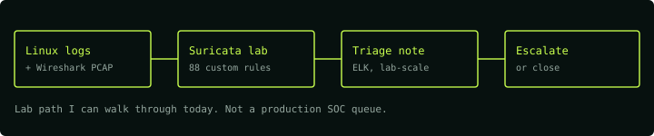

<!-- Profile README for annguyenax -->

# Nguyễn Văn An

**Final-year Information Security student @ PTITHCM** · Ho Chi Minh City, Vietnam

[Portfolio](https://annguyenax.github.io/portfolio/) · [LinkedIn](https://www.linkedin.com/in/an-nguyen-68270624a/) · [Email](mailto:annguyen11012k4@gmail.com)

---

## About Me

I am a final-year Information Security student at PTITHCM, currently applying for **SOC / Security Monitoring Intern (Tier 1)** roles.

What I can walk through today: a Suricata detection-rule lab, a 2-node Linux monitoring/logging lab, and an autoencoder-based anomaly detector evaluated on the TON_IoT dataset. I practice web security and basic pwn through CTF competitions (PTITCTF, Securinets CTF qualifiers). Long term, I want to grow from SOC/Blue Team into security research and red team work, using automation and AI-assisted workflows to speed up that learning.

  

## Current Focus

- **Target role:** SOC / Security Monitoring Intern (Tier 1).
- **Monitoring & detection:** Suricata custom rules, Wireshark, ELK, Linux logs, lab alert triage.
- **Systems & web security:** Linux/Docker labs, OWASP Top 10, JWT/RBAC backend hardening.
- **Longer-term direction:** CTF practice (web, basic pwn) and lab-scale security-research prototypes (anomaly detection, LLM security), accelerated with small automation/AI tooling.

## Highlighted Projects

| Project | Scope | Evidence |
|---|---|---|
| [suricata-ids-custom-rules](https://github.com/annguyenax/suricata-ids-custom-rules) | Individual lab | 88 custom Suricata detection rules tested in a Kali Linux lab (port scanning, SQLi, brute force, exploit traffic), with a baseline-vs-custom comparison. |
| [sre-security-platform-lab](https://github.com/annguyenax/sre-security-platform-lab) | Individual lab | 2-node Ubuntu + Docker Compose lab for monitoring, logging and hardening; every README claim is tied to saved command output. |
| [ton-iot-zero-day-ids](https://github.com/annguyenax/ton-iot-zero-day-ids) | Dataset experiment | Autoencoder trained on benign TON_IoT traffic, evaluated on unseen attacks across Network/IoT/Linux/Windows telemetry. README-reported average: 95.5% detection, **16.2% false positives** (Network layer 22%) — a lab result, not a production claim. |
| [Furniture-Web](https://github.com/annguyenax/Furniture-Web) | Solo coursework | Web Application Security course project: e-commerce platform hardened against OWASP Top 10 (RBAC, parameterized queries, Helmet, Docker isolation). |

### Research prototypes (longer-term direction)

- [realtime-c2-gnn-detection](https://github.com/annguyenax/realtime-c2-gnn-detection) — *research prototype*: C2 traffic detection via graph neural networks; reported metrics require local regeneration before being treated as verified.
- [enterprise-llm-security-framework](https://github.com/annguyenax/enterprise-llm-security-framework) — *PoC, lab-scale*: an LLM security gateway exploring defenses against prompt injection and jailbreaks for RAG applications.
- [sharepoint-sqli-research](https://github.com/annguyenax/sharepoint-sqli-research) — *fictional/portfolio exercise*: a CVE-style threat-intelligence report on a hypothetical SharePoint SQL injection, written to practice the reporting format (not a real disclosure).
- [ctf-ai-system](https://github.com/annguyenax/ctf-ai-system) — personal AI-assisted workflow (router, playbooks, skills) for organizing CTF practice; not a writeup of any single challenge.

## Contact

- Email: **annguyen11012k4@gmail.com**
- LinkedIn: **Van An Nguyen**
- GitHub: **@annguyenax**
